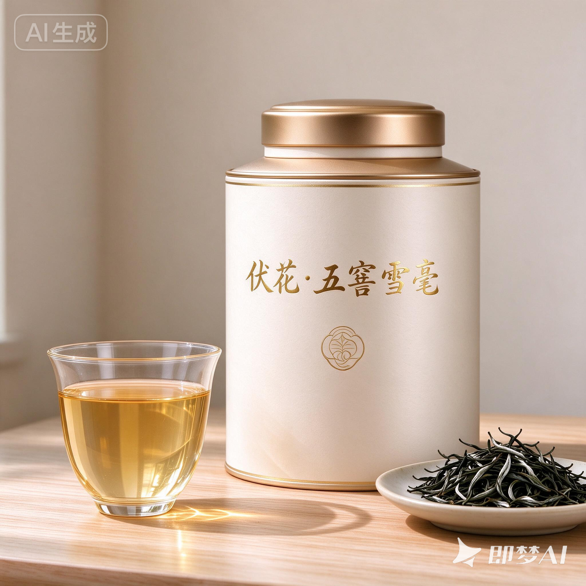

# AI 作品集

你好，我是 July。我有 1–3 年销售经验，正在转向福州的 AI 应用岗位，方向是 AI 运营/AIGC、智能体搭建和 AI 产品助理。

这个仓库会放我一个月学习期间的作品，目前包括：
- 作品 3：AI 内容生成工具包（文案、图片、短视频）
- 提示词与话术练习
- 办公自动化（后续更新）

## 目录

- [作品 3：文案](aigc-content/copywriting.md)
- [作品 3：图片提示词](aigc-content/image-prompts.md)
- [作品 3：短视频分镜](aigc-content/video-storyboard.md)
- [提示词库](prompts.md)
- [话术手册](美业招商电话销售话术手册.md)
- [Markdown 练习页](practice.md)

## 作品 3：AI 内容生成工具包

这是一套为「伏花·五窨雪毫」做的种草内容。核心卖点是**零香精、零花瓣、三泡仍香**。

文案、图片提示词和短视频分镜见上面的目录。主图如下：

其他图片：[场景图](aigc-content/day4-scene-v2.png)、[泡法图](aigc-content/day4-brew-v1.png)、[干茶特写](aigc-content/day4-detail-v2.png)、[海报](aigc-content/day4-poster-v1.png)。

成片视频还没有上传到仓库，后续再补。

## 提示词与话术

第 1 天的练习：先写提示词，再用这些提示词跑出话术手册。

学习进行中，内容会持续更新。
