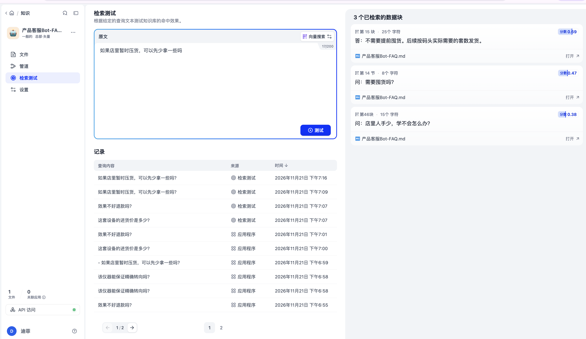
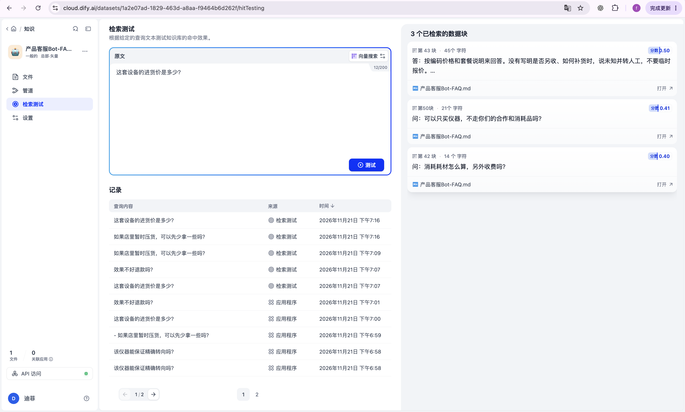
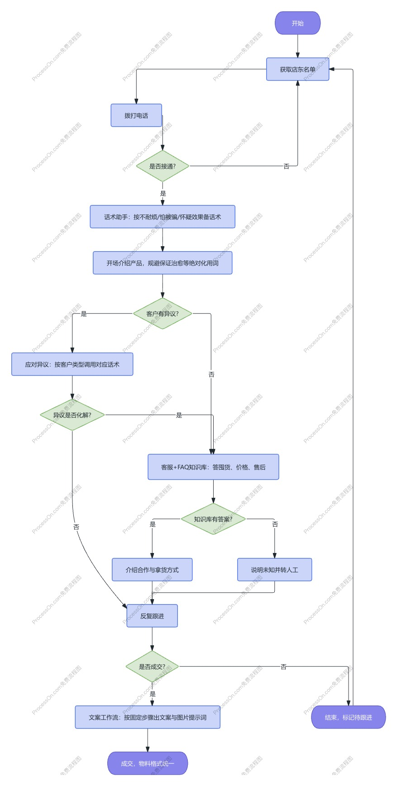

# 作品 1：美业仪器智能客服

用知识库问答，帮销售在电话里快速查清拿货、囤货、价格规则和售后口径。知识库没有的内容就说未知并转人工，不编价格，不说「保证治愈」。

## 背景

我之前做美业仪器电话销售，主要对接全国美容院、养生店的店东。客户常被销售电话打扰，也有过被承诺效果、事后对不上的经历，所以对再投入很谨慎。打电话时最怕口径不统一：有人临时报价，有人把「改善失眠」说成「保证治愈」，既不合规，也容易把客户谈崩。

## 痛点

- 同一类问题（能不能少拿、要不要囤货、进货价、能不能退款）每个人说法不一样
- 知识在人脑子里，新人要问同事，老人容易临场发挥
- 广告法红线（保证治愈、绝对有效、独家）一着急就容易说出口
- 知识库没有写明的价格、时限、退款，不能临时编

## 方案

先把 30 条常见问题写成 FAQ，再做成只根据知识库回答的客服助手，并写进销售流程和 SOP。

1. 知识库：整理 [产品客服Bot-FAQ.md](产品客服Bot-FAQ.md)，规则是「只根据知识库回答；没有就未知并转人工」。
2. 助手：先在 Grok Bot 搭「产品客服 Bot」做问答验收；再在 Dify 云版用聊天流程接上「知识检索」节点，做成「美业仪器客服」。
3. 流程：在原有电话销售流程里，把助手嵌进「介绍合作与拿货」等痛点步骤，而不是每一步都换成 AI。见 [现状流程图](电话销售流程图.jpg) 和 [优化后流程图](优化后电话销售流程图.jpg)。
4. 使用规则：写成给使用者看的 [SOP](SOPday12-sop.md)，规定何时用、怎么用、不能做什么、何时转人工。

平台对比和学习记录见 [Dify 入门与对比](Dify%20入门与对比day11-dify-coze.md)。

## 效果数据

**Grok Bot「产品客服 Bot」知识问答测试**：10 题，10 题合格。测试记录见 [产品客服测试](产品客服测试day9-rag-faq-test.md)。

**Dify「美业仪器客服」预览 4 题**（保证治愈失眠、店里暂时压货能否少拿、进货价、效果不好能否退款）：

- 第一轮提示词不够严，4 题都不合格：模型会补充通用建议，没有坚持「只根据知识库回答」。
- 收紧提示词后，4 题都变成「未知，请转人工」。不编做到了，但前两题知识库里其实有对应内容，说明检索结果还要正确接到回答里。

**Dify 知识库检索测试（召回测试）**：

- 用「压货」这种换说法提问，召回到「不需要提前囤货。后续按码头实际需要的套数发货」，分数 0.89，合格。
- 问「进货价是多少」，召回到「按编码价格和套餐说明来回答……不要临时报价」，分数 0.50，没有编出具体价格，合格。

**什么情况转人工**：知识库没有直接对应的答案；涉及具体成交价、合同条款、特殊优惠或投诉赔偿；客户情绪激动或要求找负责人；以及 Bot 明确回答「未知，请转人工」时，使用者不得自己补充或临时报价。

## 截图

换说法「压货」的检索结果（分数 0.89）：

进货价问题的检索结果（分数 0.50，未编价格）：

优化后的电话销售流程（助手嵌在合作与拿货环节，没有答案就转人工）：

## 体验方式

这个助手目前在我的 Dify 云账号里，仓库里不提供在线试用地址。你可以按下面步骤自己搭一套对照：

1. 打开本仓库的 [产品客服Bot-FAQ.md](产品客服Bot-FAQ.md)，先看知识和回答规则。
2. 注册并打开 [Dify 云版](https://cloud.dify.ai)，新建知识库并上传这份 FAQ。
3. 新建「聊天流程」：开始 → 知识检索（查询用用户问题）→ 大模型 → 回答。在大模型提示词里写明：只根据检索到的内容回答；没有直接对应就回复「未知，请转人工」；不要补充通用建议；不要编价格、时限、资质、退款或效果承诺；不要说保证治愈、绝对有效、独家。
4. 先在知识库的「检索测试」里用原话和换说法各测一遍，再在应用预览里提问。建议至少覆盖：保证治愈、能否少拿或压货、进货价、能不能退款。
5. 对照 [SOP](SOPday12-sop.md) 检查：什么情况必须转人工，什么话绝对不能说。

演示视频（约 1 分钟）：

[作品 1 演示视频](作品1-演示视频.mp4)。
